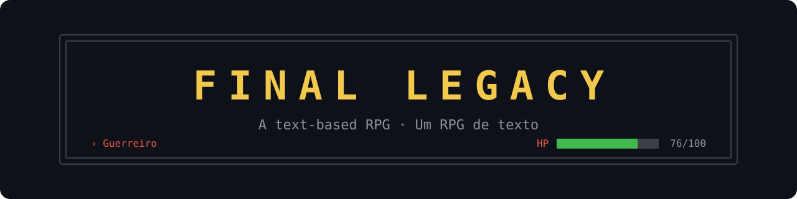
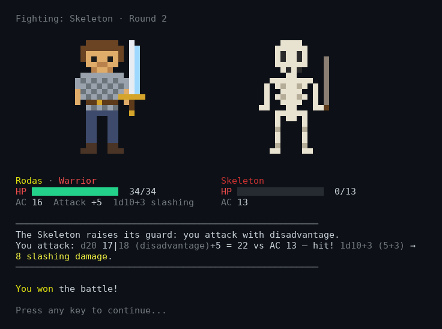
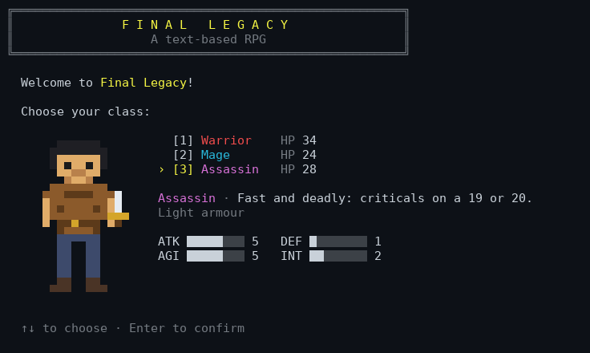
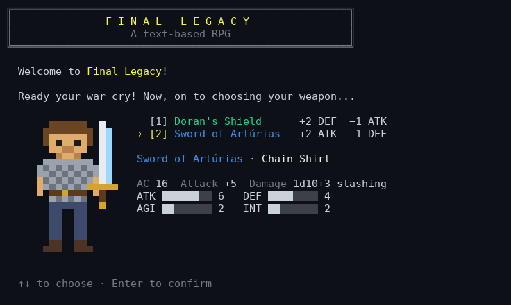
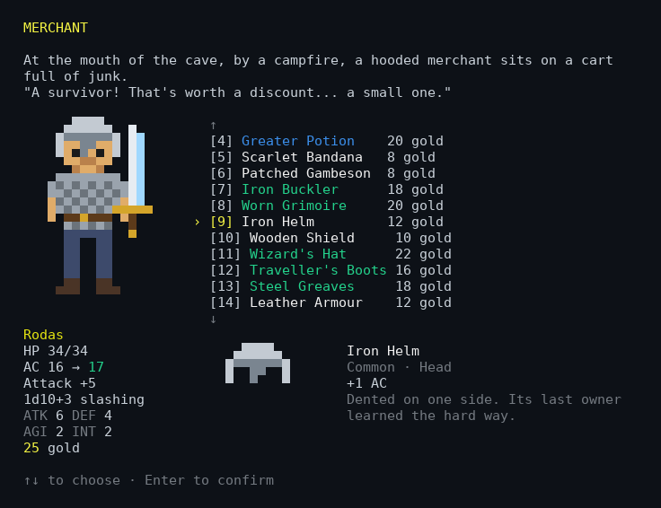
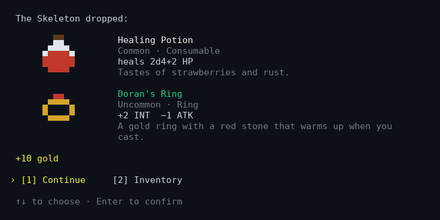
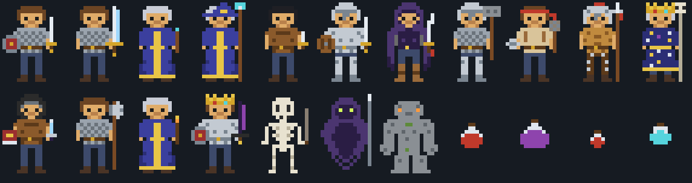

<p align="center">
  
</p>

<p align="center">
  A <b>pixel-art RPG for the terminal</b>, D&amp;D style: pick a class and a weapon, wake up in a dark cave and fight
  your way out with d20 rolls, loot, a merchant and gear that changes how your hero looks —
  in <b>Portuguese or English</b>, on Windows, Linux and macOS.
</p>

<p align="center">
  
  
  
  
  
</p>

<p align="center">
  <a href="#features">Features</a> ·
  <a href="#screenshots">Screenshots</a> ·
  <a href="#playing">Playing</a> ·
  <a href="#how-combat-works">Combat</a> ·
  <a href="#items-and-loot">Items</a> ·
  <a href="#then-and-now">Then and now</a> ·
  <a href="#writing-more-story">More story</a> ·
  <a href="#development">Development</a>
</p>

<p align="center">
  
</p>

---

Final Legacy started in 2023 as my secondary-school computer science project: 650 lines of C in one file
([the original](https://github.com/rodrigocoelho2/Final-Legacy), kept as it was in [`Original/`](Original)).
I loved making it, but I was still learning. **V2 keeps the game as it was** — the story, the three classes, the six
original weapons and their names, the Atacar / Defender / Fugir battles, the letter-by-letter text and the osteoporosis
joke — rebuilds everything underneath, and adds what it always wanted to be: an RPG with gear, loot and dice.

## Features

- **Pixel art in the terminal.** Every hero, enemy and item is a 16×24 sprite drawn with half blocks in full colour
  (256 colours where the terminal has fewer). The hero is a paper doll: **everything you wear shows** — helmets, armour,
  shields, swords, staves, cloaks, crowns.
- **D&amp;D-style combat.** d20 + attack bonus against the armour class, damage dice, natural 20 criticals (19–20 with
  keen blades), natural 1 fumbles, advantage and disadvantage — and every roll on screen.
- **Inventory and equipment** in six slots (head, chest, legs, main hand, off hand, ring), with rarities from common to
  legendary. Highlight an item and the hero **tries it on**: the picture changes and AC, attack and damage show what
  you'd gain or lose, in green and red.
- **42 items** with names and descriptions of their own — the original Doran's gear and Sword of Artúrias, and new finds
  like Thornvald's Axe, the Moonglass Dagger, the Raven Hood or the Crown of the Forgotten King.
- **Random loot.** Every enemy drops gold and rolls on a loot table weighted by rarity; the chapter's last fights can
  drop epics and, if you're lucky, a legendary.
- **A merchant** at the mouth of the cave: buy, sell, or rest by the fire. HP carries over from fight to fight, so
  potions and a night's sleep matter.
- **Class training.** Warriors wear anything and carry shields; Mages and Assassins only light armour — wear something
  heavier and every attack has disadvantage.
- **Portuguese or English**, chosen at the start. Arrow keys or numbers. Runs on Windows, Linux, macOS and in Docker,
  with no dependencies.

## Screenshots

| | |
| --- | --- |
|  |  |
| **Choose a class** — the hero shows their starting gear. | **Choose a weapon** — the original choices, now whole kits. |
|  |  |
| **The merchant** — highlight an item and the hero tries it on. | **Loot** — gold and random drops after every fight. |

<p align="center">
  
</p>

## Playing

**Download** — every push to `main` builds a single executable for Windows, Linux and macOS (Apple silicon): open the
latest [CI run](https://github.com/rodrigocoelho2/Final-Legacy-V2/actions/workflows/ci.yml), download
`final-legacy-win-x64` (or yours) and run it. Nothing else to install. Best in Windows Terminal, iTerm2, VS Code or any
modern terminal, at least 80×28.

**From the code** (.NET 10 SDK):

```bash
dotnet run --project FinalLegacy.Game
```

**Docker:**

```bash
docker build -f FinalLegacy.Game/Dockerfile -t final-legacy .
docker run -it --rm final-legacy
```

| Keys | |
| --- | --- |
| ↑ ↓ (or W S) | move through a menu |
| Enter / Space | confirm |
| 1–9 | pick an option at once |
| any key while text is being written | show the rest at once |

| Options | |
| --- | --- |
| `--lang pt` / `--lang en` | skip the language menu |
| `--fast` | text at once instead of letter by letter |
| `--no-color` | no colours and no pixel art (also when `NO_COLOR` is set) |
| `--seed 42` | the same dice every time, to replay a game |

`FINAL_LEGACY_COLORS=256` forces 256 colours on a terminal that doesn't really do 24-bit colour. The game also plays
with piped input — one answer per line, no colours, no animation — which is how CI plays the whole chapter on every
push.

## How combat works

Every round you **attack**, **defend**, **drink a potion** or **flee**, and the enemy — as in the original — randomly
attacks or guards.

- **Attacking** rolls d20 + your attack bonus against the enemy's **AC**. Your attack bonus is +2 (proficiency) plus
  the modifier of the stat your weapon uses: **ATK** for swords, axes and hammers, the better of **ATK and AGI** for
  knives and light blades (finesse), **INT** for wands and staves (arcane). A stat's modifier is half of it.
- **Damage** is the weapon's dice plus that same modifier. A **natural 20** is a critical and doubles the dice (keen
  blades crit on 19–20, the Moonglass Dagger on 18–20); a **natural 1** always misses.
- **Guarding** enemies make you attack with **disadvantage** (roll two d20, keep the lower).
- **Defending** gives the enemy disadvantage; if it misses, you **block**, and your next attack has **advantage**.
- **A potion** heals, but takes the round.
- **Fleeing** is d20 + your AGI modifier against 12, when a battle allows it (none in chapter I do, like the original).
- **Your AC** = 10 + body armour + AGI modifier (all of it in light armour, up to +2 in medium, none in heavy) + DEF
  modifier + shield, helmet and greaves.

| Class | HP | ATK | DEF | AGI | INT | Trained in | Weapon choices (kits) |
| --- | --- | --- | --- | --- | --- | --- | --- |
| **Guerreiro** / Warrior | 34 | 4 | 5 | 2 | 2 | any armour, shields | Escudo de Dorans + Iron Sword + Chain Shirt · Espada de Artúrias + Chain Shirt |
| **Mago** / Mage | 24 | 3 | 3 | 1 | 6 | light armour | Anel de Dorans + Apprentice's Wand + Robe · Bastão Desnecessariamente Grande + Robe |
| **Assassino** / Assassin | 28 | 5 | 1 | 5 | 2 | light armour | Faca de Dorans + Leather Armour · Lâmina de Shojin + Leather Armour |

The class stats and the six original weapons' bonuses are the 2023 game's, to the point.

| Enemy | HP | AC | Attack | Damage | Attacks | |
| --- | --- | --- | --- | --- | --- | --- |
| Esqueleto / Skeleton | 13 | 13 | +3 | 1d6+1 slashing | 60 % | |
| Sombra Misteriosa / Mysterious Shadow | 20 | 13 | +4 | 1d8+2 necrotic | 70 % | fast and relentless |
| Golem de Pedra / Stone Golem | 26 | 14 | +4 | 1d10+2 bludgeoning | 50 % | slow, armoured |

Chapter I was balanced by simulating thousands of fights for every kit: the skeleton is almost always won; the last
fight is won 80–98 % of the time by a player who drinks their potions — and lost more often by one who doesn't.

## Items and loot

| Rarity | Items |
| --- | --- |
| Common | Iron Sword · Rusty Mace · Apprentice's Wand · Wooden Shield · Apprentice's Robe · Patched Gambeson · Leather Armour · Chain Shirt · Iron Helm · Scarlet Bandana · Studded Breeches · Minor Potion · Healing Potion |
| <span>Uncommon</span> | Doran's Knife · Doran's Shield · Doran's Ring · Watchman's Spear · Bone Staff · Iron Buckler · Worn Grimoire · Wizard's Hat · Raven Hood · Steel Greaves · Traveller's Boots · Greywolf Ring · Mist Tonic |
| Rare | Sword of Artúrias · Unnecessarily Large Staff · Blade of Shojin · Thornvald's Axe · Ember Wand · Plate Armour · Vessar Breastplate · Broken Guardian Helm · Ember Seal · Greater Potion |
| Epic | Granite Hammer · Moonglass Dagger · Shadow Cloak · Astral Tunic |
| Legendary | The Nameless Blade · Crown of the Forgotten King |

Each enemy has a **loot table**: gold in a range, its signature drop on a chance of its own (the Shadow's cloak, the
Golem's hammer), then a number of **random rolls** — each draws a rarity by weight (or nothing) and a random item of
that rarity. The cave's chest rolls too.

| Loot | Gold | Signature | Rolls | Nothing | Common | Uncommon | Rare | Epic | Legendary |
| --- | --- | --- | --- | --- | --- | --- | --- | --- | --- |
| Chest in the cave | 5 | Healing Potion | 1 | | 70 | 30 | | | |
| Skeleton | 5–10 | Healing Potion (50 %) | 2 | 30 | 48 | 18 | 4 | | |
| Shadow / Golem | 15–25 | Shadow Cloak / Granite Hammer (50 %) | 2 | 5 | 15 | 35 | 30 | 12 | 3 |

## Then and now

| | 2023 (C) | V2 (.NET 10) |
| --- | --- | --- |
| Runs on | Windows only (`windows.h`, `conio.h`, `system("cls")`) | Windows, Linux, macOS, Docker |
| Language | Portuguese | Portuguese or English, chosen at the start |
| Look | coloured text | pixel art: heroes, enemies, every item |
| Combat | attack / defend / flee, ATK and DEF | d20 rolls, AC, damage dice, criticals, advantage — all four stats count |
| Gear | one weapon choice | 42 items in six slots, a bag, a merchant, random loot |
| Structure | one 650-line `main` with `goto` | an engine (Library) and a console (Game), with the story, stats, items and sprites in data files |
| Tests | — | 62 unit tests and a full playthrough in CI |

**Bugs fixed on the way** (each one has a test):

- The menu loops were `while (arma != 1 || arma != 2)`, which is always true: the only way out was a `goto`.
- `if (arma = 1)` assigned instead of comparing.
- Choosing *Fugir* always said "Não podes fugir desta batalha", even in a battle you could flee (missing braces).
- Agility and intelligence were shown but never used.
- The Mysterious Shadow and the Stone Golem had exactly the same stats.
- Typing a letter at a menu sent the game into an endless loop (`scanf("%d")` never consumed it).
- The name was read with `scanf("%s")` into 30 characters: a longer name overflowed the buffer, and a space cut it.
- The accents had turned into `�` (the file was saved in the wrong encoding), and a stray `p` on line 53 stopped it
  compiling at all.

## Writing more story

The story, the items and the art are data: chapter II needs no new code.

- [`story.json`](FinalLegacy.Library/Content/story.json) — the scenes and how they connect. A scene is a **narration**
  (`text` + `goto`), a **choice** (`text` + `choices`, each with a `goto`, or a `reply` that answers and asks again —
  like "Não" in the cave), a **battle** (`battle: { enemy, canFlee }` + `win`, and `flee` when it can be fled), a
  **loot** scene (`loot: { gold, items, rolls, rarity }`), a **shop** (`shop: { stock, rest }`) or an **end**.
  Choice scenes get an *Inventory* option on their own.
- [`items.json`](FinalLegacy.Library/Content/items.json) — every item: slot, rarity, price, stat modifiers, and
  `weapon` (damage dice, type, stat, two-handed, keen), `armor` (AC, weight) or `heal`.
- [`sprites.json`](FinalLegacy.Library/Content/sprites.json) — a palette of letters and every sprite as rows of them
  (`.` is see-through). An item's sprite is a layer over the hero: draw only its rows.
- [`rules.json`](FinalLegacy.Library/Content/rules.json) — classes, kits, enemies and their loot tables.
- [`pt.json`](FinalLegacy.Library/Content/pt.json) and [`en.json`](FinalLegacy.Library/Content/en.json) — every text,
  by key. `{name}` is the hero's name; `[gold]…[/]`, `[amber]`, `[red]`, `[crimson]`, `[cyan]`, `[violet]`,
  `[green]`, `[blue]`, `[white]` and `[dim]` colour it; `[pause]` is the original's slow "...".

`ContentTests` checks that every scene leads somewhere real, every enemy and item exists and has a sprite, every
sprite row is 16 wide and uses palette colours, every loot table can find items of its rarities, both languages have
every text and no tag is misspelled — so a broken chapter fails the build instead of a game.

## Development

```
FinalLegacy.slnx
├── FinalLegacy.Library/        the game without the console (no dependencies)
│   ├── Content/                rules, items, sprites, story, pt and en (embedded JSON), their loader and validator
│   ├── Models/                 Stats, classes, kits, enemies, loot tables, the Hero (equipment, bag, AC, attack)
│   ├── Items/                  Item, weapons, armour, potions
│   ├── Combat/                 Dice and d20 rolls, Battle (the rules), BattleNarrator (the rolls in words)
│   ├── Sprites/                SpriteBook: the palette and the paper-doll layering
│   ├── Story/                  the scene graph
│   ├── Adventures/             Adventure (a playthrough, loot, inventory, merchant) and IGameUi (what it needs from a screen)
│   ├── Localization/           the texts of a language and their {placeholders}
│   └── Text/                   the [colour] markup
├── FinalLegacy.Game/           the console
│   ├── Terminal/               GameTerminal: keys or piped lines, colours, colour depth, Windows console setup
│   └── Ui/                     TerminalUi (every screen), PixelArt (half-block sprites), MenuPrompt, Draw
├── FinalLegacy.UnitTest/       xUnit: d20 combat with loaded dice, equipment, loot, content, whole playthroughs
└── Original/                   the 2023 C source, untouched
```

The Library knows nothing about the console: `Adventure` asks an `IGameUi` for every choice and hands it pictures as
pixel grids, so the tests play the whole story with a scripted player, and a web version later would only need another
`IGameUi`.

```bash
dotnet test FinalLegacy.UnitTest
```

GitHub Actions (`.github/workflows/ci.yml`) builds and tests everything, plays the whole chapter in both languages with
piped answers (the transcripts are kept as an artifact), publishes the single-file executables and builds and runs the
Docker image.

## Credits

The Doran's items, Shojin and the unnecessarily large staff are a nod to League of Legends; Final Legacy is not
affiliated with Riot Games. Everything else — names, art and story — is original.
